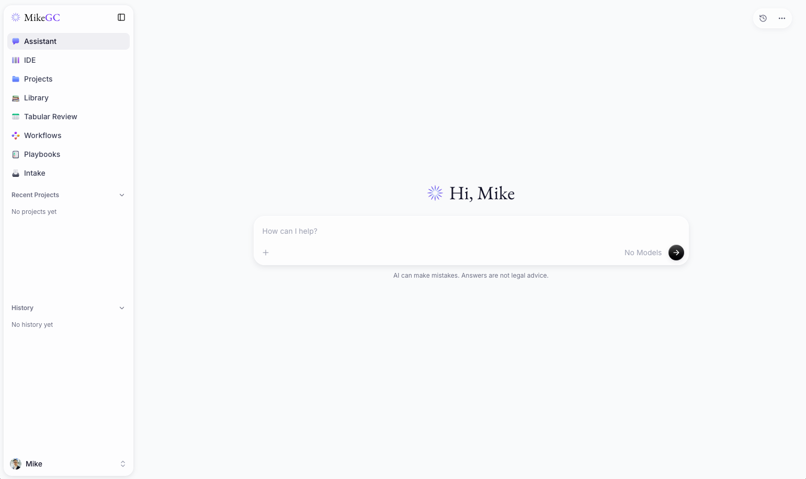

# Spectre

Spectre is a legal AI assistant for lawyers and in-house legal teams in
Bangladesh. It reviews and drafts documents in Bangla and English, knows the
Bangladeshi court system and citation formats, looks up Acts on the Laws of
Bangladesh, and uses OpenAI by default while keeping every other supported
model provider available.

Spectre is built on MikeGC, a fork of [Mike (MikeOSS)](https://mikeoss.com),
the open-source legal AI platform for document review, drafting, and legal
research.

> [!NOTE]
> Spectre is a work in progress. Features and setup may change without notice.

## Bangladesh

See [Spectre for Bangladesh](docs/bangladesh.md) for what is adapted, how to
deploy with OpenAI, and the limits lawyers should know about. In short:

- **OpenAI by default**: set `OPENAI_API_KEY` and every chat, review, title,
  intake and background task runs on OpenAI with no model to pick first.
  Anthropic, Gemini, Mistral, routers and local models still work.
- **Bangladeshi law**: answers follow Bangladeshi law and procedure unless
  you say otherwise, cite cases in DLR, BLD, BLC, MLR and SCOB form, and flag
  Acts that the 2024-2026 ordinances changed.
- **Laws of Bangladesh lookup**: the assistant searches and reads Acts and
  sections on bdlaws.minlaw.gov.bd and links to them.
- **Proper Bangla**: Bangla answers, Bangla in generated Word and PowerPoint
  files, Bangla fonts for PDF conversion, correct matching and highlighting of
  Bangla quotes, repair of Bangla text extracted from PDFs, and conversion of
  legacy Bijoy (SutonnyMJ) documents to Unicode.
- **Scans and broken PDFs**: pages with no usable text are transcribed by a
  vision model (Bangla OCR), and garbled text layers never reach the model.
- **Checkable authorities**: every DLR, BLD, BLC or SCOB citation an answer did
  not read in a source is shown as not verified.
- **Court-ready output**: word-level Word tracked changes, HCD paper books to
  the 2012 Rule, Bangla-calendar dates and the Sunday to Thursday week.
- **Five corporate use cases** with real tracked-change redlines in
  [docs/examples/bangladesh](docs/examples/bangladesh/README.md), and 19
  Bangladesh workflows.
- **Confidentiality**: OpenAI is told not to store responses.

## Upstream sponsorship

Disclosure: MikeGC, on which Spectre is built, is sponsored by
[GENERAL LEGAL, LLP](https://general.legal).

## In-house features

Included now:

- **Playbooks**: turn your team's Word or PDF negotiation guide into
  structured rules and review contracts against them. See
  [Playbooks](docs/playbooks.md).

- **Intake**: the Legal team's tracker for NDA requests and legal questions
  from the business, with assignment, notes, target dates and recorded
  resolutions. See [Intake](docs/intake.md).

Planned, starting with:

- **Horizon scanning**: track regulatory updates relevant to the business.

## Built on Mike

Spectre keeps the full Mike platform. It combines a Next.js frontend, an Express backend, Supabase Auth/Postgres,
and Cloudflare R2-compatible object storage.

Website: [mikeoss.com](https://mikeoss.com)



## Features

- Chat with legal documents and open matters
- Review documents and apply suggested edits
- Run reusable assistant and tabular-review workflows
- Organize projects, folders, and a document library
- Verify citations and research US case law with CourtListener
- Work from Microsoft Word with the task-pane add-in
- Run supported language models locally through Ollama

## Quick start

The included Docker Compose stack runs Spectre, Supabase, RustFS object storage,
and local email capture without requiring managed infrastructure.

1. Copy the local environment templates:

   ```bash
   cp .env.example .env
   cp backend/.env.example backend/.env
   ```

2. In `backend/.env`, set `DOWNLOAD_SIGNING_SECRET` and
   `USER_API_KEYS_ENCRYPTION_SECRET` to separate values generated with:

   ```bash
   openssl rand -hex 32
   ```

3. Add an Anthropic, Gemini, or OpenAI API key to `backend/.env`, unless you
   plan to use Ollama exclusively.

4. Start the stack:

   ```bash
   docker compose up --build
   ```

5. Open [http://localhost:3000](http://localhost:3000) and create an account.

To stop, run `npm run stack:down` rather than `docker compose stop`: stopped
containers are never removed on their own and keep images and volumes in use.
See "Stop and clean up" in `docs/local-development.md`.

The bundled credentials and infrastructure are intended for local development
only. See [Local development](docs/local-development.md) for service endpoints,
authentication behavior, Ollama setup, and first-run guidance.

### Telemetry

Spectre sends scrubbed error reports (no document content, user identities, or
request data) to the project's Sentry by default. Set `SENTRY_DISABLED=true` to
opt out, or set `SENTRY_DSN` to use your own. See the
[observability guide](docs/observability.md) for the exact policy, per-runtime
variables, and the [Sentry data audit](docs/sentry-data-audit.md).

## Repository

| Path | Purpose |
| --- | --- |
| `frontend/` | Next.js web application |
| `backend/` | Express API, document processing, and database access |
| `word-addin/` | Microsoft Word task-pane add-in |
| `backend/schema.sql` | Complete schema for fresh databases |
| `backend/migrations/` | Dated migrations for existing deployments |
| `docker-compose.yml` | Local application and infrastructure stack |
| `docs/` | Development, deployment, testing, and feature guides |

## Documentation

- [Documentation index](docs/README.md)
- [Local development](docs/local-development.md)
- [Manual and production deployment](docs/deployment.md)
- [Troubleshooting](docs/troubleshooting.md)
- [MCP connectors](docs/connectors.md)
- [Google Workspace: Drive, Gmail, and Calendar](docs/google-workspace.md)
- [CourtListener integration](docs/courtlistener.md)
- [Microsoft Word add-in](word-addin/README.md)
- [Tamper-evident exports](docs/tamper-evident-exports.md)
- [Safe local testing](docs/safe-local-testing.md)
- [Preset contract templates and publisher credits](docs/preset-templates.md)
- [End-to-end testing and CI](docs/e2e-ci.md)
- [Contributing](CONTRIBUTING.md)
- [Open-source credits](CREDITS.md)
- [Security policy](SECURITY.md)

## System workflows

Spectre's system assistant and tabular-review workflows are maintained in the
[`open-legal-products/mikegc-workflows`](https://github.com/open-legal-products/mikegc-workflows)
repository, licensed under Apache 2.0. See
[Contributing](CONTRIBUTING.md#system-workflows) for how they are packaged and
synchronized with this application.

## License

Spectre, like Mike, is available under the [GNU Affero General Public License v3.0](LICENSE).
Bundled [public contract templates](docs/preset-templates.md#maintaining-the-catalog)
retain their publishers' separate licenses and notices.
